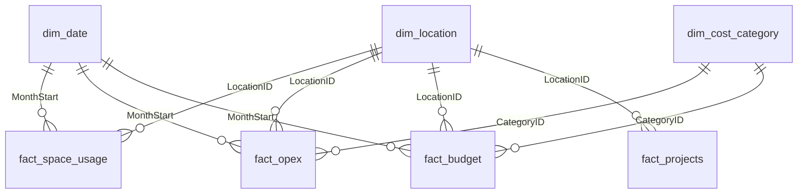

# SQL relational model (Phase 3)

> **All data is synthetic.** Offices, people and figures are invented; nothing here describes a real company.

Engine: **SQLite** (tested with 3.45.1 through Python's `sqlite3`). Dates are ISO text (`YYYY-MM-DD`). The DDL uses standard constructs, so moving to PostgreSQL needs only small type edits (`TEXT`→`DATE`, `REAL`→`NUMERIC`).

Files: `sql/01_schema.sql` (tables, constraints, indexes, views), `sql/02_validation.sql` (38 checks), `sql/03_business_queries.sql` (15 queries). Build the database with `python tests/build_database.py`.

## Entity relationships

| From (many) | To (one) | Key | Cardinality | Enforced by |
|---|---|---|---|---|
| fact_space_usage, fact_opex, fact_budget, fact_projects | dim_location | LocationID | many-to-one | FOREIGN KEY |
| fact_space_usage, fact_opex, fact_budget | dim_date | MonthStart | many-to-one | FOREIGN KEY |
| fact_opex, fact_budget | dim_cost_category | CategoryID | many-to-one | FOREIGN KEY |
| fact_opex ↔ fact_budget | (same grain) | LocationID + MonthStart + CategoryID | one-to-one | `UNIQUE` on both tables + validation check |

`fact_projects` is **not** linked to `dim_date`: project dates are daily, the calendar is monthly. `param_as_of` is a one-row constant table (30 Sep 2026) with no relationships.

## Grain

| Table | Grain | Natural key (UNIQUE) | Rows |
|---|---|---|---|
| fact_space_usage | location × month | LocationID, MonthStart | 288 |
| fact_opex / fact_budget | location × month × category | LocationID, MonthStart, CategoryID | 1,440 each |
| fact_projects | project | ProjectID | 27 |

## Views

| View | Purpose |
|---|---|
| `vw_cost_actual_budget` | opex joined to budget at their shared grain (1,440 rows, no fan-out) |
| `vw_office_month` | one row per office-month (288): costs are collapsed to office-month **before** joining space usage, so area, desks and headcount are never multiplied by the 5 cost categories |
| `vw_project_status` | per-project overdue flag, budget consumed, cost-vs-progress index, days late / overdue (as-of date from `param_as_of`) |

## The one trap this model is built around

Summing `FloorAreaM2`, `Desks` or `Headcount` over `fact_opex` or `fact_budget` counts each office five times. Rate KPIs therefore take their denominators from `vw_office_month` (one row per office-month). The test suite demonstrates the trap (area summed over opex rows is exactly 5× the area-months) and checks that a category filter changes only the numerator.
